# 03-instalacion-proxmox

## Objetivo

El objetivo de la fase 3 es instalar Proxmox VE dentro de una VM de VirtualBox, configurando la RAM, CPU, adaptadores RED correspondientes siguiendo el diagrama de red creado en la fase anterior y el almacenamiento .vdi. Para finalmente acceder a la web proxmox por la ip del nodo de proxmox desde el buscador.

## Procedimiento

### Fase 3. Instalacion de Proxmox

1-Instalar la iso de proxmox 9.2.2 y montarla en VirtualBox con sistema operativo Linux.

2-Desde VirtualBox, configurar los recursos de la VM (CPU de 2 nucleos, RAM de 8GB, ALMACENAMIENTO de 80GB) y sus adaptadores de red correspondientes (NAT y adaptador solo anfitrion).Una vez creada la mquina Proxmox activo la opcion Nested VT-x/AMD-V para poder realizar virtualizacion anidada, ademas el controlador SATA esta conectado al disco con la opcion virtio-scsi.

3-Dentro de la VM Proxmox, configurar la red del laboratorio: Desde la consola de la VM se edita /etc/network/interfaces para añadir vmbr1 sobre nic0 con 192.168.56.10/24 y se aplica con ifreload -a, vmbr1 hace de gateway de los invitados, con reenvío de IP y Red NAT hacia vmbr0, tal como indica la tabla.

4-Acceder al panel web de Proxmox mediante la ip configurada: Desde el navegador del equipo anfitrión: https://192.168.56.10:8006 (usuario root, reino «Linux PAM»)


### Fase 4. Configuración base del nodo

1- Reviso donde se guardara cada cosa desde el panel de proxmox y desde la maquina virtual:
    En el panel de proxmox, abro Datacenter > Storage y reviso los almacenamientos disponibles. Aparecen 2, local (tipo Directory, con 23,7 GB libres y 4GB libres, donde se guardan imagenes ISO, plantillas CT y backups segun la configuracion), y local-lvm (tipo LVM-thin, con 30 GiB libres y 0 % usado, donde se guardan discos de VM y volvmenes CT).
    En la maquina virtual de proxmox uso los comandos pvesm status (para ver los almacenamintos disponibles y su estado) y df -h (para ver el espacio total y el espacio disponible del sistema de archivos). 


## Comandos usados

### Fase 3. Instalacion de Proxmox

```bash
ip -br link
ip-br addr
ip route
pveversion
df -h

nano /etc/network/interfaces
ifreload -a

nano /etc/hosts
hostname -f

reboot
```

### Fase 4. Configuración base del nodo

```bash
pvesm status

df -h

ip route replace default via 10.0.2.1 dev vmbr0
nano /etc/network/interfaces
```

## Evidencias

### Fase 3. Instalacion de Proxmox


**Recursos y Red:**

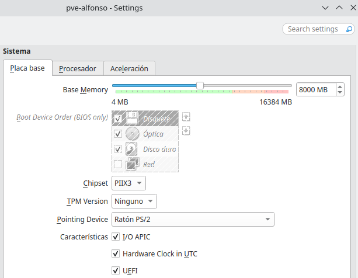

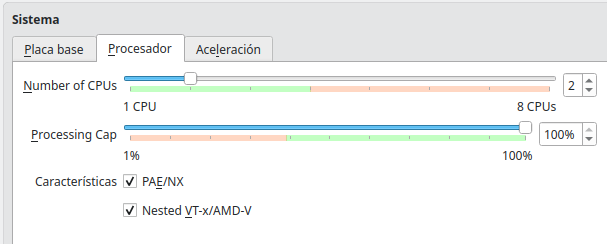

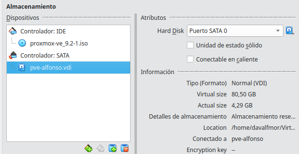

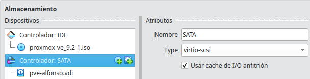


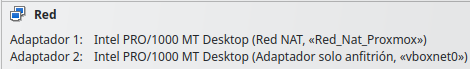

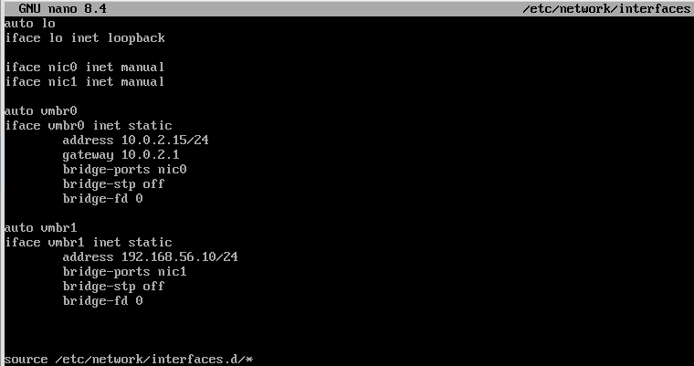

**Salida de: hostnamectl, ip -br addr, pveversion, df -h**

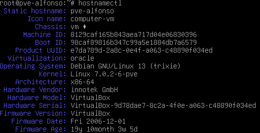

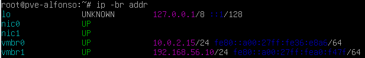

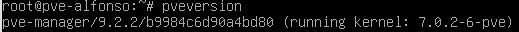

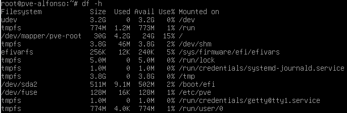

**Panel de Proxmox:**

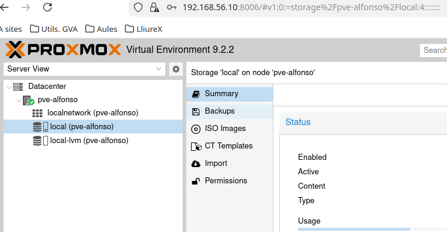


### Fase 4. Configuracion base del nodo

**Almacenamiento**

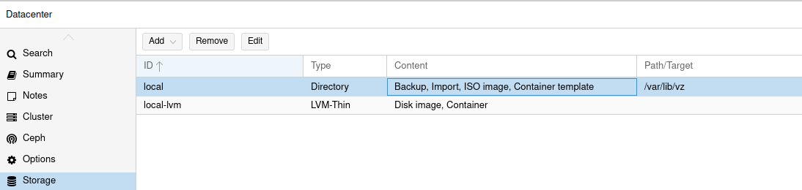

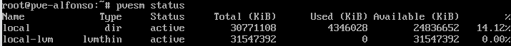

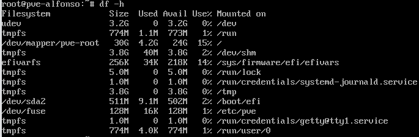


## Incidencias

He tenido un error en mi Proxmox porque no tenia acceso a internet debido a que el gateway estaba configurado para la ip 10.0.2.2 en vmbr0, he cambiado la gateway a la 10.0.2.1 y ya tiene acceso a internet. Para cambiarlo he ejecutado ip route replace default via 10.0.2.1 dev vmbr0 para establecer la ruta getaway por defecto, y he cambiado el archivo de configuracion de interfaces de red mediante nano /etc/network/interfaces.

## Conclusion

Ya esta montado el Proxmox en una VM con sus recursos establecidos y la red configurada, esta comprobado que funcione el panel web de Proxmox. Ahora solo falta que tenga capacidad de salida a internet, que se hara en el siguiente paso.

[Volver al indice](../README.md)
